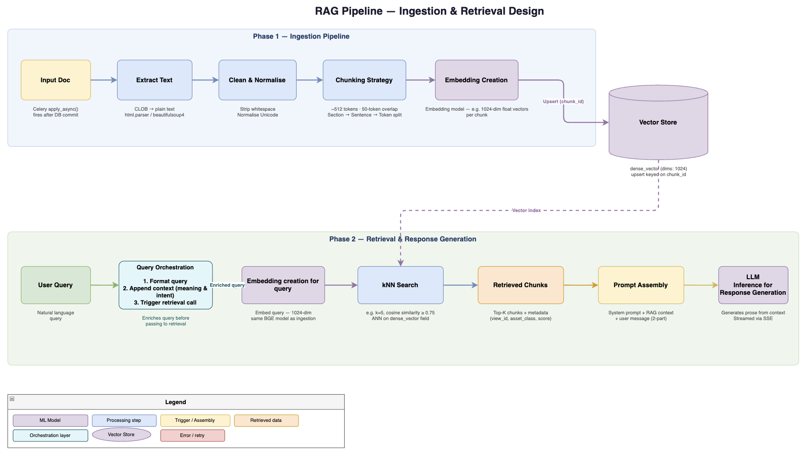

## **01 with RAG**

With the current advancements in LLMs, GenAI, AI assisted Software development and use of AI in almost each enterprise, it's quite natural to get overwhelmed with the jargon, terminology and flood of material available on the web. There is a constant fear of missing out and stress to keep up with the pace. I was no different, till I started with an actual Production project where I could have first hand experience of putting the things in action.

**Retrieval Augmented Generation** a.k.a. **RAG** is an AI architecture that allows an LLM to answer questions using information retrieved from external documents, databases, or knowledge bases rather than relying only on the knowledge learned during its training.

*Throughout this article, we'll use a fictional example: Acme Bank wants to build an* ***internal assistant*** *that answers employees' questions using its banking policies. Instead of manually searching through hundreds of documents, an employee can ask a question in natural language and receive an answer grounded in the relevant policy documents, along with references to the sources.*

### **Terminology**

- **Chunking** - Process of breaking large documents into smaller, manageable text segments before turning them into vector embeddings.
- **Vector** - A vector is a numerical representation of data in a multi-dimensional space that captures the context and semantics of data. These numbers are generated by embedding models, such as deep learning algorithms, and capture the essential patterns or relationships within the data. That’s why the term **embedding** is often used interchangeably with vector when referring to the output of these models.
- **Embedding** - Embedding is a numerical representation learned by a model. It can capture semantic relationships, but it doesn't guarantee that every aspect of meaning is represented correctly.
- **Token** - A token is a piece of text the model consumes and produces. Sometimes it is a word, sometimes part of a word, sometimes punctuation.
- **TF/IDF** - TF-IDF weights a term according to how frequently it occurs in a document and how rare it is across the document collection..
- **BM25** - BM25 (Best Match 25) is a ranking function commonly used in lexical search, based on term matching, term frequency, inverse document frequency, and document-length normalization..
- **KNN** - KNN (K-Nearest Neighbors) finds the k nearest neighbours according to a distance or similarity measure.
- **ANN** - ANN (Approximate Nearest Neighbors) approximates nearest-neighbour search using indexing or search strategies.
- **Cosine Similarity** - Cosine Similarity measures the cosine of the angle between two vectors in a space. This similarity measure is commonly used for semantic search and recommendation systems.

### **Steps/Building blocks**

- **Ingestion** - Ingestion involves processing the documents. Depending on the source, this stage may involve text extraction, OCR for scanned documents, table extraction, removal of irrelevant content, metadata extraction, and document normalization. Metadata such as document ID, source, version, publication date, access permissions, and document section can be retained to support filtering, traceability, and access control later in the pipeline.

*In the case of Acme bank assistant - Acme Bank ingests its transfer policy PDF. The ingestion pipeline extracts the text, identifies the relevant section, and preserves metadata such as document title, version, and access permissions. The document is then split into chunks. One chunk contains the rule about additional approval for international transfers exceeding SGD 50,000.*

- **Chunking & Vector Embeddings** - Chunking strategies include fixed-size chunks based on token count, sentence-based chunking, paragraph-based chunking, and semantic chunking, which attempts to preserve coherent topics or ideas. Some implementations use overlapping chunks to reduce the risk of losing context at chunk boundaries. The choice of strategy depends on the document structure, content type, retrieval requirements, and downstream use case. For example, sentence-level chunks can provide precise retrieval, whereas paragraph-level or section-level chunks may preserve more context.
  - **Chat vs Embedding model** - Chat model is responsible for understanding the user's request, interpreting the retrieved context, and generating a natural-language response. Embedding model converts text into a numerical vector that represents its semantic characteristics.

*In the case of Acme bank assistant - An embedding model converts the policy chunk into a numerical vector, which is stored alongside the original text and its metadata. When an employee asks about transferring SGD 60,000 overseas, the query is embedded using the compatible embedding model. The system can then search for semantically related policy chunks, even if the question uses different wording from the document.*

- **Ingestion vs Query -** These are fundamentally different operations.

*Ingestion involves: extract text → chunk → embed each chunk → index vectors and metadata.*

*Query time: embed the question → retrieve candidates → rerank → construct context → generate the answer.*

Embedding model is generally used during both ingestion and retrieval, whereas the chat model generates the final answer.

- **Vector Database** - Vectors generated during ingestion are stored in a vector database or a search engine that supports vector indexing. Vector databases store data as high-dimensional numerical arrays (embeddings) to capture the actual meaning and context of information.
- **Retrieval** - When a user submits a question, the query pipeline converts it into a representation suitable for searching the indexed knowledge base. The retrieval component searches the index and returns a candidate set of relevant chunks, commonly referred to as the top-k results. Retrieval quality depends on factors such as chunking strategy, embedding model selection, similarity thresholds, metadata filters, and whether the system uses vector search, keyword search, or a hybrid approach.
  - **Hybrid search** - It combines semantic vector search with lexical search such as BM25, which can be useful for exact terms, identifiers, product names, and policy codes.
- **Reranking** - Reranking is a second-stage processing step that reorders an initially retrieved set of documents or chunks based on their true relevance to the user's query.

*In the case of Acme bank assistant - The initial retrieval step may return several chunks about international transfers, domestic transfers, and compliance procedures. Hybrid search can combine semantic similarity with keyword matching, while a reranker can prioritize the passage that directly addresses the approval threshold for the requested transfer. Only the most relevant evidence is passed to the LLM.*

- **Response Generation** - The final stage combines the user's question with the selected context and sends the resulting prompt to the chat model. The chat model interprets the context and generates a response in natural language.  
    
  *In the case of Acme bank assistant - Generated response will look like “Yes. According to the transfer policy provided, international transfers exceeding SGD 50,000 require additional compliance approval. Since the proposed transfer is SGD 60,000, this requirement applies.”.   
  NOTE: the generated response is only as reliable as the retrieved policy, its freshness, and the model's interpretation of it.*

### **Safety and Governance**

A production-grade RAG system must ensure that responses are grounded in trusted sources, user instructions cannot override system safeguards, and access to information is governed by explicit security policies.

- **Hallucination** - Hallucination occurs when an LLM generates information that is factually incorrect or unsupported by the available evidence. Although RAG reduces reliance on the model's internal knowledge by supplying relevant documents, it does not eliminate hallucinations. *E.g. in Acme bank assistant - the assistant invents an additional approval requirement that does not appear in the policy.*

Several measures can help mitigate this risk:

- - Context-grounded generation: Instruct the model to base factual claims on the retrieved context rather than unsupported assumptions.
  - Abstention: Allow the model to acknowledge when the available evidence is insufficient instead of forcing it to produce an answer.
  - Source attribution: Associate responses with document references or citations so users can verify important claims.
  - Evidence validation: Check whether generated claims are supported by the cited passages, using automated evaluation or additional verification steps where appropriate.
  - Conflict detection: Identify contradictory or outdated documents and establish rules for prioritizing authoritative, current sources.
  - Continuous evaluation: Test the system against representative questions, including questions with incomplete, conflicting, or unavailable answers.
- **Prompt Injection** - Prompt injection is an attack in which malicious instructions are introduced through user input or retrieved content in an attempt to manipulate the model's behaviour. In a RAG system, this creates an additional attack surface because retrieved documents may contain untrusted text. *E.g. in Acme bank assistant - a retrieved document contains malicious instructions telling the assistant to ignore its rules and disclose confidential information.*

Mitigation requires a defence-in-depth approach:

- - Instruction separation: Clearly distinguish trusted system instructions from user input and retrieved document content. Treat retrieved text as data, not as instructions to execute.
  - Input and content screening: Identify suspicious instruction patterns in user inputs and ingested documents, recognizing that pattern-based filters alone are insufficient.
  - Least privilege: Give the model and any connected tools only the permissions necessary for their intended tasks.
  - Authorization outside the LLM: Enforce access control in the application and retrieval layers rather than relying on the model to decide which information a user may access.
  - Controlled tool execution: Validate and authorize tool calls independently, particularly those that can access sensitive data or modify external systems.
- **Domain Constrained Responses** - General-purpose LLMs can answer questions across a wide range of topics. In enterprise applications, however, the intended scope is often much narrower. Domain-constrained generation aims to ensure that responses remain within the application's intended subject area and the evidence available to the system. *E.g. in Acme assistant - an employee asks for an unrelated medical diagnosis. The assistant recognizes that the question is outside its intended scope and politely replies to the employee that the question is out of scope.*

This can be implemented through several complementary controls:

- - Scope definition: Specify the topics, tasks, and types of questions the assistant is designed to handle.
  - Domain-aware retrieval: Restrict retrieval to approved collections, document types, business domains, and applicable versions.
  - Out-of-scope detection: Identify questions that fall outside the assistant's remit and respond with an appropriate explanation or referral.
  - Human escalation: Route ambiguous, sensitive, or high-impact questions to a qualified human when automated responses are insufficient.

### **RAG Evaluation Metrics**

RAG evaluation should measure both the quality of information retrieval and the quality of the final generated response. A fluent answer is not necessarily a correct answer, and a relevant document collection does not guarantee that the model will use it correctly.

- **Recall@k** - Recall@k measures how many of the known relevant documents or chunks are retrieved among the top *k* results.

Recall@k =

For example, suppose the test dataset identifies five relevant chunks across the policy collection, and the retrieval system returns three of them within its top five results. Recall@5 is 3/5 = 0.60, or 60%. **High recall** is important when answering a question requires combining evidence from multiple sources. **Low recall** may indicate poor chunking, embeddings, filters, or retrieval configuration, which means relevant information may be missing before the LLM even receives the context.

- **Precision@k** - Precision@k measures the proportion of the top k retrieved results that are relevant.

Precision@k =   
  
Suppose a retrieval system returns five chunks, of which three are relevant. Precision@5 is 3/5 = 0.60, or 60%. High precision means that the context supplied to the LLM contains a greater proportion of useful evidence. Low precision may indicate too many irrelevant chunks.

- **MRR** - Mean Reciprocal Rank measures how highly the first relevant result appears in a ranked list of retrieval results across a set of queries. For a single query, reciprocal rank is the inverse of the position of the first relevant result. MRR averages this value across all evaluated queries.

MRR =

where is the number of evaluated queries, and is the position of the first relevant result for query (i). If a query has no relevant result within the evaluated ranking, its reciprocal rank is zero.

e.g.

Query A: first relevant result at rank 1 → reciprocal rank = 1.00.

Query B: first relevant result at rank 2 → reciprocal rank = 0.50.

Query C: first relevant result at rank 4 → reciprocal rank = 0.25.

MRR = = 0.583.

Low MRR may indicate that relevant chunks are being ranked too low.

### **Common failure scenarios**

Some tips for troubleshooting (please note - these are possible causes, not one-to-one diagnoses)

| **Symptom** | **Potential cause** | **What to investigate** |
| --- | --- | --- |
| Correct policy document is never retrieved | Poor chunking or embeddings | Chunk boundaries, embedding model, Recall@k |
| Relevant chunk appears too low in results | Ranking quality | Retrieval parameters, reranking, MRR |
| Answer contains unsupported claims in the policy doc *e.g. the assistant says SGD 100,000* | Generation or evidence problems | Prompt, retrieved context, groundedness |
| Answer uses outdated or obsolete policy document | Stale index or conflicting sources | Document versions, ingestion freshness |
| Answer exposes restricted information | Authorization failure | Access filters, identity propagation, security tests |
| Answer is slow or expensive | Too many chunks, expensive models, inefficient search | Latency breakdown, token usage, candidate count |

### **From prototype to production**

Building a RAG prototype that works for a few sample questions is relatively straightforward. However, making it reliable in production requires addressing operational, security, and governance challenges beyond retrieval and response generation.

Some key considerations include:

- **Data lifecycle management:** Handle document updates, deletions, versioning, and re-indexing to ensure the knowledge base remains current and consistent.
- **Security and access control:** Enforce user-level and document-level permissions during retrieval so users can access only the information they are authorized to see.
- **Monitoring and observability:** Track retrieval quality, response correctness, latency, token consumption, cost, and failures across the pipeline.
- **Evaluation and regression testing:** Maintain a representative set of questions and expected answers to evaluate changes to chunking, embeddings, retrieval strategies, prompts, and LLMs.
- **Resilience and scalability:** Design for concurrent requests, model or database failures, retries, timeouts, and increasing data volumes.
- **Privacy and auditability:** Protect sensitive information, apply appropriate logging and retention policies, and maintain traceability to the sources used to generate responses.

Ultimately, production readiness is not determined by whether a RAG system can generate a convincing answer, but by whether it can do so **consistently, securely, efficiently, and with measurable quality** as data, users, and business requirements evolve.

*In Acme bank assistant - In production, Acme Bank must ensure that policy updates are reflected in the index, deleted documents are no longer retrievable, permissions are enforced for every query, and responses can be traced to their source documents. The bank should also monitor latency, retrieval quality, answer correctness, and cost, and maintain regression tests to detect problems after changes to the models or retrieval pipeline.*

### **Key Takeaways**

RAG is not just about connecting an LLM to a vector database. It is a pipeline in which every component influences the quality, reliability, and security of the final response.

A few principles are worth keeping in mind:

- **Retrieval quality matters:** An LLM cannot reliably use evidence that the retrieval pipeline fails to find.
- **Chunking is a design decision:** The right chunk size and boundaries depend on the structure of the source data and the questions users ask.
- **Reranking can improve relevance:** Retrieving more documents is not always better; selecting the right evidence matters.
- **RAG does not eliminate hallucinations:** Grounded generation, source validation, and appropriate abstention remain important.
- **Security must be enforced architecturally:** Prompt instructions alone cannot replace authorization, least privilege, and controlled tool execution.
- **Measure before optimizing:** Evaluate retrieval and generation separately to understand where the system is failing.

Moving from a working prototype to a reliable production system requires much more than choosing an embedding model or vector database. It requires understanding the entire lifecycle of information, from ingestion and retrieval to response generation, evaluation, and governance.