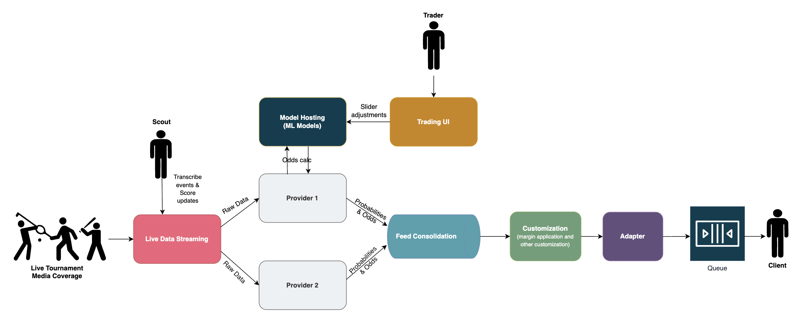
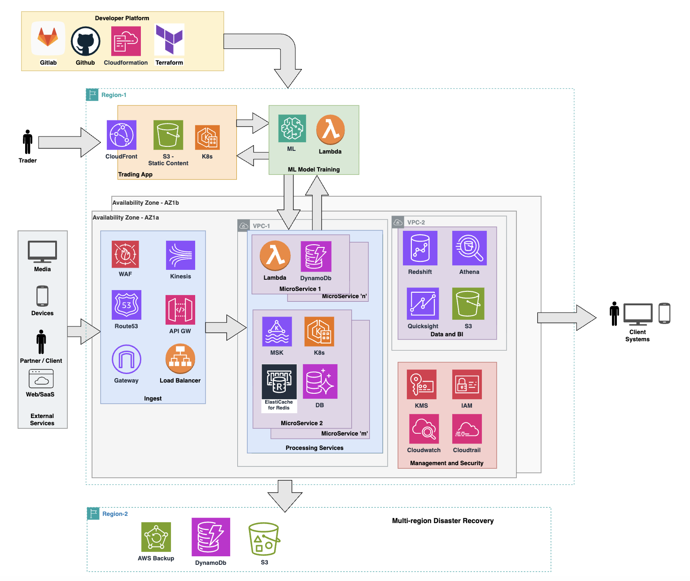

## The evolving landscape of the sports industry

The sports and entertainment industry (which includes sports betting and gaming) has undergone a rapid transformation in recent years, fueled by advances in cloud computing, data engineering and real-time digital platforms. What was once a niche business limited to physical betting shops has now evolved into a global, always-on digital ecosystem, where milliseconds matter and user expectations are higher than ever.

At the heart of this transformation is technology-driven innovation, reshaping both user experience and operational efficiency in several ways such as:

- **Web and mobile applications:** With the rise of mobile-first experiences, bettors can now place wagers anytime, anywhere, making accessibility a key driver of engagement.
- **AI and data analytics:** Artificial intelligence and big data analytics play a crucial role in odds calculation, risk assessment and fraud detection, improving accuracy and fairness.
- **Live betting and streaming integration:** In-play betting has become a significant attraction, allowing users to place bets in real time as matches unfold.
- **Blockchain and cryptocurrencies:** Some platforms now offer blockchain-based transactions, enhancing security, transparency and payment efficiency.

## Challenges of sports betting platforms

Sports betting platforms may look similar to other platforms on the surface such as banking and e-Commerce. Both handle users, payments and high traffic, but architecturally and operationally they face different challenges.

- **Traffic patterns can be volatile and bursty**. Traffic is event driven and unpredictable. It also fluctuates constantly depending on the state of ongoing matches - there may be spikes during goals, penalties and injuries. On the contrary, in other platforms such as banking or e-commerce, traffic is more predictable and spikes can be planned in advance.
- **Real-time data processing vs eventually consistent flows**. Platforms in the sports industry require near real-time processing, whether for calculating odds or accepting or rejecting bets. Stale odds or data can cause financial loss. On the contrary, in many other platforms minor delays are acceptable but **eventual consistency** is of utmost importance.
- **Latency sensitivity**. Unlike other platforms, sports betting is highly latency sensitive. Even milliseconds matter when it comes to odds calculation and bet acceptance. In other platforms, slower loading of a page or app can be tolerated; this isn’t possible in a live match where stakes are high and where automated bots try to quickly take advantage of arbitrage situations caused by slow updates to odds during match events.
- **Availability**. In sports betting and tech platforms, downtime is unacceptable. It leads to lost revenue and damages user trust. With other platforms, planned short maintenance windows are still acceptable.
- **Regulatory and compliance complexity**. Sports betting is a highly regulated industry. Various requirements exist for **auditing** and **regulatory** compliance which includes audit logs, data protection and fraud detection amongst others. There is also a high volume of data involved that needs protection and proper handling.

## Why sports content systems demand modern architecture

Sports platforms are fundamentally **event-driven systems**. There are hundreds of parallel matches across different sports globally at any given point in time. A single goal, red card or last-minute play can trigger a massive **surge in user activity and data ingestion and thus leads to volatile and spiky traffic.** This makes sports content ingestion and processing a perfect candidate for **digital transformation** - especially when trust and reliability are key tenets of any new platform.

Functional architecture of a real-time sports betting platform

However, it also brings certain challenges and architecture requirements, such as:

- **Performance efficiency.** The system MUST be architected for performance and scalability due to bursty event traffic, where ingestion rates spike sharply during key match moments and fluctuate continuously throughout the game. The system MUST bake in best practices such as caching, throttling and network optimizations to improve overall performance of the system
- **Operational excellence**. The ability to efficiently **deploy, operate, monitor** and manage different workloads and services is critical. **Observability** must be baked in from day one, with robust monitoring, logging and alerting to detect anomalies, diagnose issues and ensure system health during peak traffic windows.
- **Reliability** and **high availability** is non-negotiable. Platforms must reliably process a highly large number of concurrent events across multiple sports and leagues.
- **Security**. Platforms need to enforce strong security controls, including network protection, access management and a **“shift-left” security mindset** to mitigate risks early in the development lifecycle.
- **Cost** **efficiency.** Real-time, high-throughput systems can quickly increase the costs of infrastructure and management if they’re not carefully managed. The platform needs to offer visibility into infrastructure and operational costs and actively reduce waste to ensure sustainable growth.
- **Organizational and operational impact.** Beyond technical scalability and performance, the absence of modern architecture has significant organizational consequences, often leaving a long-term impact on the business i.e**.** hidden costs**.** When systems aren’t designed for elasticity, automation,and scaling, the burden to maintain them **shifts from technology to people** - larger teams such as site reliability engineering, devops; which, in turn, means increased operational costs. This in the long term also leads to inflated costs, slower time-to-market for new sports/content, teams’ burnout and talent retention challenges.

## Cloud native approach

The challenges outlined above such as bursty event traffic, real-time ingestion, high availability, strict security requirements and cost control are faced by any organization working within the sport and entertainment industry. This is precisely where a **cloud-native architecture** becomes not just beneficial, but essential.

The [**AWS well-architected framework**](https://docs.aws.amazon.com/wellarchitected/latest/framework/welcome.html) provides a set of best practices organized around different pillars that align closely with the operational realities of live sports data platforms. Also their [**Games Industry Lens**](https://docs.aws.amazon.com/wellarchitected/latest/games-industry-lens/games-industry-lens.html) provides domain specific insights.

Distributed, event-driven cloud native sports betting platform on AWS

1. **Performance efficiency -** Ability to react in milliseconds to live match events such as goals, penalties and odds changes triggering immediate spikes in both event ingestion and user interactions. With the use of public cloud such as **AWS**, this can be achieved by:
   - Distributed architecture and **microservices** for better performance
   - **Auto-scaling** compute managed services - EC2 Auto Scaling, EKS (Elastic Kubernetes Service) or Lambda, to absorb bursty event traffic
   - High-throughput, **low-latency ingestion** using API GW, Managed Kafka Service.
   - Compute model **(containers vs serverless)** based on workload. **Serverless** for better Scalability and **Elasticity** e.g. Lambda and DynamoDb
   - Best practices e.g. **Caching** (Elasticache Redis)
2. **Operational excellence** - Efficiently deploy, operate, monitor and manage using cloud native approach:
   - **Automated deployments**: GitLab CI/CD pipelines help automate code integration and faster delivery.
   - **Infrastructure as Code**: Terraform and AWS Cloud Development Kit(CDK) used to help manage Infrastructure as Code, making deployments repeatable, auditable and fast.
   - **Built-in observability**: AWS Cloudwatch and similar tools to check the health and performance of the system and raise alerts for anomalies
3. **Security -** A fully comprehensive platform handles sensitive user, financial, company and transactional data. Modern platforms need to keep in mind **shift-left** security and **security-by-design**, a cloud native approach offers:
   - Network isolation using **Virtual Private Clouds**, security groups and private subnets
   - Strong Identity and Access Management
   - **Encryption** at rest and in transit using AWS Key Management Service
4. **Reliability -** Platforms need to be highly reliable and highly available. A Cloud Native approach outshines in this regard by offering:
   - **High availability** - Multi-AZ architectures
   - **Managed services** (e.g., Amazon MSK, DynamoDB and Elastic Kubernetes Service ) that handle failover automatically
   - **Disaster recovery** - Persisting in secondary regions.
   - **Event-driven patterns** that decouple producers and consumers, preventing cascading failures
5. **Cost optimization -** Traffic patterns are inherently uneven - massive peaks during live matches followed by quieter periods. A cloud-native approach enables:
   - Monitor and control cost using **Cost Explorer**
   - **Pay-as-you-go** pricing model
   - Auto-scaling and **serverless** architectures that scale down during off-peak hours thus better **Elasticity**
   - Resource tagging and budgeting: Helps to monitor cost based on projects, applications and environments. This aligns with [**AWS Migration Acceleration Program**](https://www.thoughtworks.com/en-gb/about-us/partnerships/cloud/aws/map-migration-modernization) **funding** as well.
   - Review and optimize: Identify and free unused and underused resources. **Right-sizing** resources help save excess cost.

## Real world impacts after migration to AWS

Beyond architectural principles and best practices, the benefits of moving a Sports platform from on-premise to AWS become most evident when measured against real production metrics. In one such real world migration for a client, the improvements were both immediate and measurable.

1. **Faster time to market (Business agility) -** Onboarding a new sport or new source of data improved substantially by adoption of AWS, **modern architecture** and self-serve capabilities. Time taken to onboard a sport was reduced from approx **2.5 months** to **1.5 months**, thus an improvement of **~40%**.
2. **Latency Improvements** - Average latencydropped by nearly **55%** as compared to on-prem infrastructure. Lower latency directly translates to faster updates and improved user trust.
3. **CPU & Processing Throughput -** CPU processing capacity (events/sec) increased almost **thrice**, from ~**1K to ~3K events/sec**. This allowed the platform to absorb match day spikes without pre-provisioning or aggressive over-scaling.
4. **Network Throughput -** Network throughput improved by **~40%**. This directly benefited **event ingestion,** events propagation and downstream fan out services. High network throughput is critical in sports platforms where events must be processed and distributed in real time.

These improvements were primarily driven due to cloud-native compute and networking, use of managed AWS services, multi-AZ resilience and elastic scaling. Most importantly, the gains were achieved while **reducing operational overhead**, proving that such architectures not just scale better but operate more efficiently with smaller teams.

## Lessons learnt

The core lessons for building robust sports betting platforms revolve around embracing a cloud-native, event-driven architecture and prioritizing operational stability.

First, choose compute instances wisely by going serverless (using services like AWS Lambda, API Gateway, DynamoDB and EventBridge) for event-driven, bursty workloads and using containers (such as AWS EKS, Elastic Container Services, Fargate and MSK) for stateful or long-running tasks.

Second, embrace event-driven architecture early to decouple producers and consumers and utilize asynchronous APIs (like AWS EventBridge, SNS and MSK).

Third, invest heavily in observability and debuggability through end-to-end tracing, high-cardinality metrics and structured logging with correlation IDs, leveraging tools like AWS CloudWatch, X-Ray, New Relic, Prometheus and Grafana.

Fourth, make failure a first-class citizen by building for graceful degradation, applying circuit breakers and timeouts and testing with chaos experiments, supported by AWS features like Auto Scaling and Multi-AZ deployments.

Finally, automate cost controls early to prevent platforms from becoming cost sinks by using autoscaling and serverless to avoid over-provisioning and monitoring cost per business transaction, with help from AWS Cost Explorer, resource tagging and serverless architectures.

## Conclusion

The sports and entertainment industry has evolved into high demand real-time **digital ecosystems**. These are event-driven platforms where **latency, availability and correctness** directly translate into revenue, trust and regulatory compliance. Such platforms a.k.a. systems must be designed to absorb unpredictable match-day spikes and remain resilient under high load, all while maintaining security and cost controls.

This is where a **cloud-native approach**, guided by the **AWS Well-Architected Framework**, proves its value. By embracing managed services, event-driven patterns, automation and built-in observability, sports betting platforms can:

- Scale instantly
- Operate reliably
- Maintain regulatory confidence and auditability
- Control long-term infrastructure costs

Beyond technical benefits, a cloud-native approach delivers **organizational leverage** - allowing smaller, more focused teams to build, operate and evolve large-scale platforms without sacrificing stability or speed.

Modern cloud-native architecture is thus no longer optional, rather it is the foundation for sustainable growth, operational excellence and competitive advantage in the evolving sports betting industry.